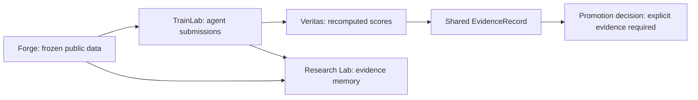

# Woyengi Intelligence Labs ecosystem

Open infrastructure for reproducible AI research, training and independent
capability verification. The public software already uses Apache-2.0; this guide
makes the existing shared repository easier to enter. It does not announce a new
release, novel scientific capability or validated customer demand.

The [diagnostic workbench](diagnostic-workbench.md) adds capability-declared
adapters, explicit check coverage and a bounded session timing ledger. Its
[roadmap](diagnostic-roadmap.md) separates the implemented slice from broader
dataset, training, behavioral and repair diagnostics still to build.

| Component | Owns | Start here |
| --- | --- | --- |
| Veritas | Executable environments, verifier semantics, evaluation and qualification contracts | [Veritas](../../README.md), [commercial entry point](../commercial/README.md) |
| Forge | Temporal release integrity, source declarations, immutable split and dataset identities | [Forge](../../integrations/forge/README.md) |
| TrainLab | Trusted command execution, reproducible run records, diagnostics and artifact integrity | [TrainLab](../../integrations/trainlab/README.md) |
| Research Lab OS | Experimental protocol, queue, research-memory and evidence coordination | [Research Lab](../../integrations/research_lab/README.md) |



Existing PyTorch, Hugging Face, Ray, MLflow, DVC, HUD, Prime and Harbor installations
can remain the owned training, tracking or execution systems. Supported adapters
and their limits are in the [compatibility matrix](compatibility.md). A proposed
integration is not an implemented adapter. The ecosystem does not need to become
a replacement trainer, generic MLOps platform or GPU cloud to provide assurance.

## Install and run locally

Use Python 3.12+ and a checkout of this branch. Installation may download the
public runtime dependencies. Running the comparison then needs no account,
subscription, API key, model download, GPU or Woyengi-hosted backend:

```bash
python -m venv .venv
. .venv/bin/activate
python -m pip install . ./integrations/forge ./integrations/trainlab ./integrations/research_lab
veritas-ecosystem run .trainlab/public-comparison
veritas-ecosystem verify .trainlab/public-comparison
trainlab serve --runs .trainlab/public-comparison/runs
```

`veritas-ecosystem` ships with the experimental Research Lab package. It requires
the other three installed components for this full-stack workflow. There is no
published or verified `pip install woyengi-research` command. Install a single
component from its existing directory when that is all you need. No repository
or import renaming is necessary.

Use a new output directory. The example freezes 30 **public constructed** subjects
into Forge train/validation/test groups, passes only as-of validation payloads to
two existing scripted policies, and records their actual submissions in TrainLab.
Veritas recomputes reward and admissible evidence from the saved submissions and
its separately stored evaluator fixture. It also checks constructed positive and
negative verifier controls. Research Lab indexes the dataset, both runs and the
comparison in its local evidence graph, without launching workers or claiming
independent scientific review.

The policies are `public_evidence_reference` and `projection_trust`. They are
transparent scripted baselines, not language models or newly trained architectures.
The fixture is deliberately designed to contrast admissible source evidence with
misleading projections; a 1-versus-0 reward here does not estimate real agent
performance or competitive advantage. TEST bytes are verified for dataset
integrity and never scored. No training, weight update or protected TEST evaluation
occurs. The existing [PyTorch path](../../integrations/trainlab/PYTORCH.md) supplies
separate constructed model-training and checkpoint/export checks.

## Inspect the evidence

The dashboard's `submission_count` metric records execution. Use
`comparison.json` for the independently recomputed Veritas scores.

The output retains:

- `agents/protocol.json`: frozen split, cutoff, seed, evaluator and driver digests,
  selected package versions and installed Python-source tree identities;
- `agents/dataset/`: the immutable Forge release and its file checksums;
- `operator/episodes.json`: evaluator fixtures for this **public constructed**
  example only; these are not sealed benchmark assets;
- `runs/`: both TrainLab receipts, stdout/stderr and prediction artifacts;
- `comparison.json`: recomputed aggregate results, bindings and promotion state;
- `evidence.json`: the existing shared `EvidenceRecord`, with opaque artifact
  references and `outcome: OBSERVED`;
- `research_lab/lab.sqlite3`: experimental local evidence memory.

| Proposed evidence tuple | Concrete binding in this example |
| --- | --- |
| D — data | Forge manifest SHA256, split integrity and feature cutoff |
| C — code/environment | Driver SHA256, four Python-source tree digests, Python and selected package versions |
| M — model | Scripted policy IDs; `checkpoint: null` |
| T — training/compute | Frozen protocol; `NOT_PERFORMED` training; observed process wall time only |
| R — result | Saved submissions, run-receipt hashes and recomputed aggregate rewards |
| V — verification | Existing CompanyWorld verifier, constructed controls and separate scoring process |
| P — promotion | `NOT_PROMOTED` / `NOT_QUALIFIED` with an explicit reason |

This reuses the [shared evidence contract](../evidence/shared-evidence-contract.md)
rather than creating another evidence authority. `veritas-ecosystem verify` rejects
changed data, evaluator fixtures, saved artifacts, declared run metadata,
installed source trees and forged summary scores. It recomputes results instead
of trusting an agent's claimed reward. Its local scorer is independent of the
agent's reported metrics; it is not a separate human/organization or an external
replication. The source/version snapshot is not a full OS, binary dependency,
resource-isolation or signed-provenance attestation.

All recipe code is trusted and shares the local account. A hostile agent could
read neighboring files; the directory/API separation is not a sandbox for hidden
benchmarks. Keep actual protected evaluators in their established boundary.
Rewriting an entire local evidence chain is outside file-checksum protection.
Snapshots and reports confer no source rights, qualification or release authority.

## Reproduce and contribute

Another developer can install the same source and rerun into a fresh directory.
The fixture, predictions and aggregate scores should reproduce exactly. Run IDs,
wall time and environment-bound evidence identities need not match across hosts.
The [clean-install workflow](../../.github/workflows/ecosystem-quickstart.yml)
checks built-wheel installation outside the checkout, the CLI, package license
text and the independent verifier path. A missing/skipped gate remains unverified.

See [CONTRIBUTING.md](../../CONTRIBUTING.md), [GOVERNANCE.md](../../GOVERNANCE.md)
and [SECURITY.md](../../SECURITY.md). The [launch worklist](open-source-launch.md)
separates implemented software, unverified external proof and proposed commercial
tests. Private benchmarks and customer assets remain outside the public Apache
software grant according to [LICENSING.md](../../LICENSING.md).
